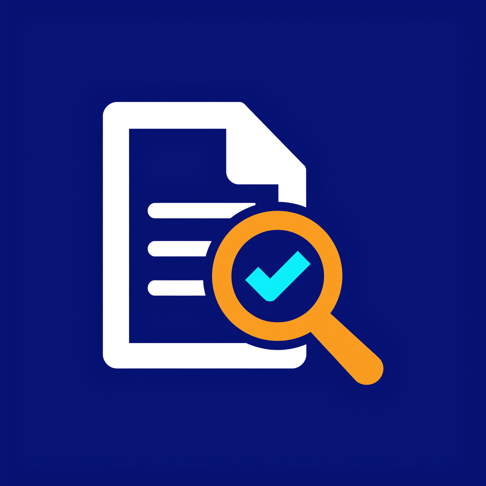

# auditoria-cv



Skill de Claude que te entrevista y reescribe tu CV (hoja de vida, currículum, resume) en dos modos:

1. **CV genérico**: un CV fuerte para un tipo de rol y mercado, comparado contra ofertas reales y recientes.
2. **CV a medida de una oferta**: comparado contra la vacante, la empresa y su proceso de selección.

## Cómo funciona

| Fase | Qué pasa |
|---|---|
| 0. Enfoque | Te pregunta el modo, el rol, el mercado, el idioma y tu situación. |
| 1. Insumos | Te pide el CV actual (PDF o DOCX) y, si aplica, la oferta. |
| 2. Diagnóstico | Extrae el texto como lo haría un ATS y detecta PDF-imagen, columnas, tablas, texto oculto y contacto o fechas que no se leen. |
| 3. Investigación | Busca en la web la oferta, la empresa y el ATS que usan, o varias ofertas recientes del rol. |
| 4. Brechas | Cruza los requisitos contra tu CV: cubierto, parcial o ausente. |
| 5. Entrevista | Te pide métricas, periodos, alcance y experiencia real con cada requisito. |
| 6-7. Entrega | Te entrega el CV nuevo en DOCX y PDF, verificado de nuevo con el diagnóstico, más un informe QUITAR / CAMBIAR / MEJORAR / AÑADIR. |

Parte de cómo se filtra hoy: primero las preguntas eliminatorias del formulario, luego el parseo, después la búsqueda y el ranking con IA (que priorizan, casi nunca rechazan solos) y al final el triaje humano. No inventa métricas ni usa trucos como el texto oculto: cada cifra del CV nuevo tiene una fuente o la confirmas tú.

## Instalación

### Claude Code (recomendado, con actualizaciones)

```
/plugin marketplace add dux14/auditoria-cv
/plugin install auditoria-cv@auditoria-cv
```

**Activa las actualizaciones automáticas** (vienen apagadas por defecto en marketplaces de terceros): `/plugin` → *Marketplaces* → `auditoria-cv` → *Enable auto-update*. Así recibes cada cambio que se publique en este repo al iniciar Claude Code. Para actualizar a mano: `/plugin marketplace update auditoria-cv`.

Solo necesitas Python 3.9+. La skill instala sola lo demás la primera vez: `uv` (con pip, sin permisos de administrador), las librerías (pdfplumber, python-docx y Playwright) y Chromium para el PDF. No hace falta poppler, LibreOffice ni pandoc.

### Claude (app o web)

1. Descarga `auditoria-cv-<versión>.skill` desde [Releases](https://github.com/dux14/auditoria-cv/releases/latest).
2. Ve a *Customize → Skills → + → Upload a skill* y sube el archivo.
3. Para actualizar, borra la versión anterior y sube la nueva. Claude.ai no actualiza las skills personales desde GitHub.

### Otros agentes (estándar Agent Skills)

```bash
npx skills add dux14/auditoria-cv     # instalar
npx skills update                     # actualizar
```

O copia `skills/auditoria-cv/` a la carpeta de skills de tu agente.

## Uso

- «Ayúdame con mi CV» o «Adapta mi CV a esta oferta: <enlace>». La skill arranca con las preguntas de enfoque.
- Se activa sola cuando mencionas CV, hoja de vida, resume, ATS, una oferta de trabajo o LinkedIn.

## Contenido

| Ruta | Para qué sirve |
|---|---|
| `skills/auditoria-cv/SKILL.md` | Flujo y reglas |
| `skills/auditoria-cv/references/` | Cómo filtran los ATS y la IA, preguntas de la entrevista, mercados, redacción, plantilla del informe y LinkedIn |
| `skills/auditoria-cv/assets/cv-ats-base.md` | Esqueleto de CV a prueba de parser |
| `skills/auditoria-cv/scripts/parse_check.py` | Diagnóstico de lo que extrae un ATS (PDF o DOCX) |
| `skills/auditoria-cv/scripts/build_cv.py` | Markdown a DOCX, HTML y PDF de una columna |
| `.claude-plugin/` | Manifiestos de marketplace y plugin de Claude Code |

## Límites

- Los datos de mercado de `references/` llevan fecha. Reverifícalos antes de basar decisiones en ellos.
- No es asesoría legal (visas, autorización de trabajo).
- No inventa logros: lo que no tiene evidencia se marca o se retira.

## Contribuir

Issues y pull requests son bienvenidos, sobre todo para actualizar datos o añadir mercados. Registra los cambios en `CHANGELOG.md` y corre las pruebas:

```bash
uv run -q --with pdfplumber --with python-docx --with playwright --with pytest --with pypdf --with pillow pytest -q tests/
claude plugin validate .
```

## Publicar

Las actualizaciones llegan a los usuarios cuando cambia `version` en `.claude-plugin/plugin.json`: súbela en cada release (formato `AAAA.MM.N`) y crea el tag correspondiente, que también genera el `.skill` para claude.ai:

```bash
git tag v2026.12.1 && git push origin v2026.12.1
```

El workflow `.github/workflows/release.yml` corre las pruebas, empaqueta el `.skill` y lo adjunta al release.

## Licencia

[MIT](LICENSE)
